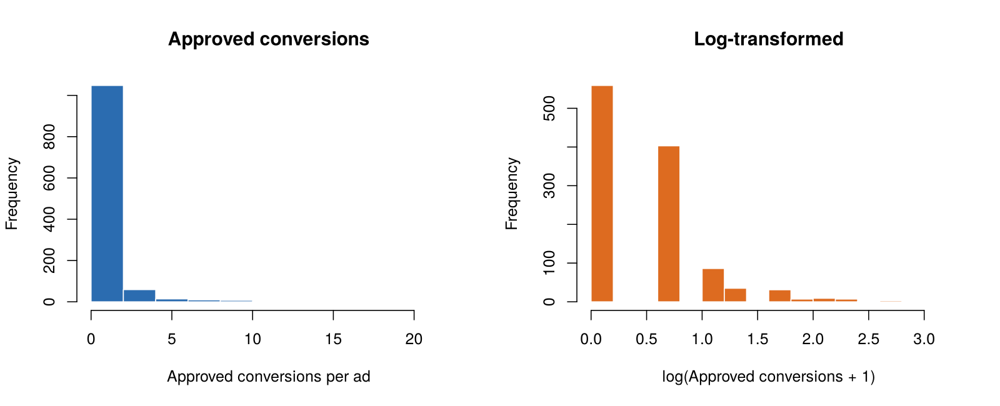
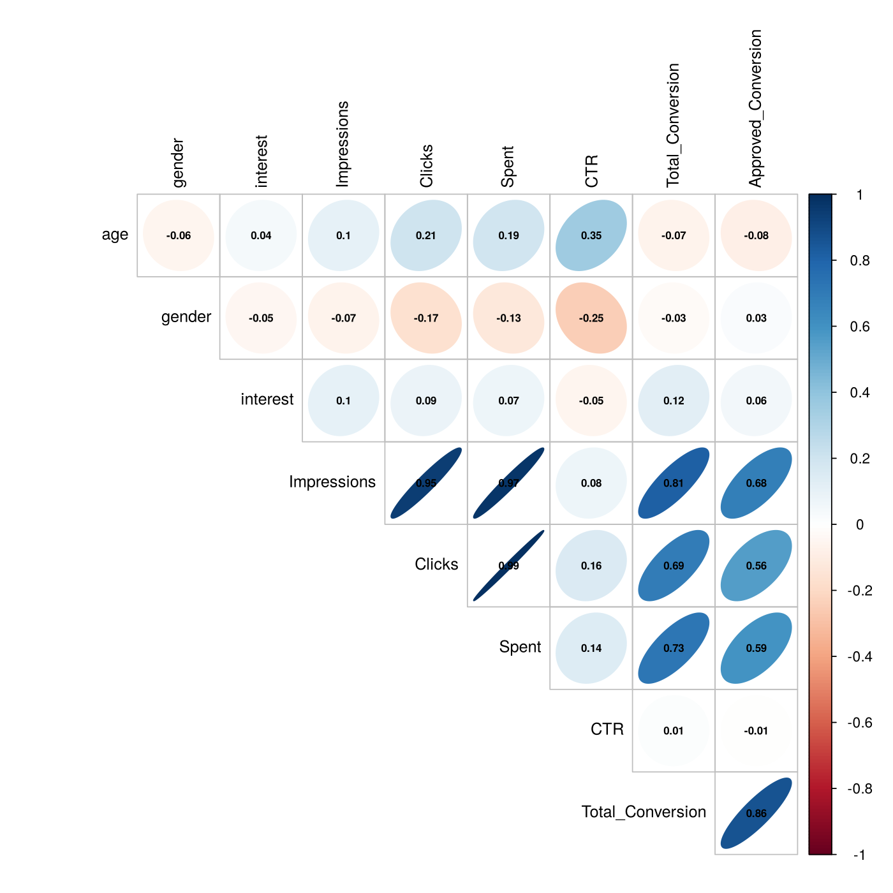
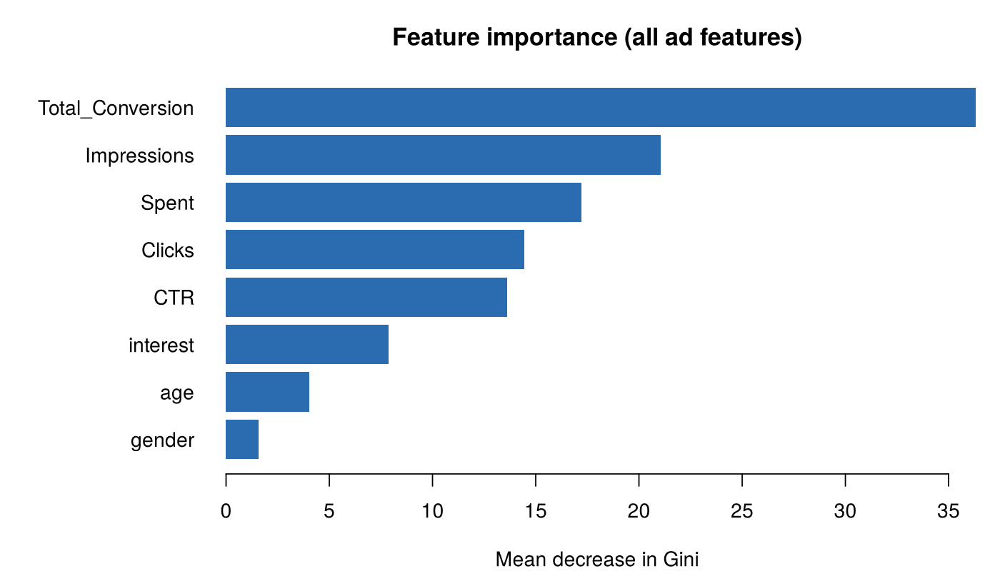
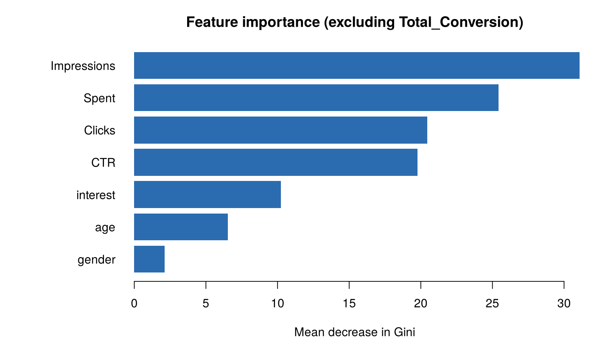

# Facebook Ad Conversion Analysis (R)

Which ad features actually drive purchases, and can we flag high-converting ads before the budget is spent?
This project classifies 1,143 Facebook ads as **Low**, **Average** or **High** converting using Naive Bayes and Random Forest, and evaluates the models on the metrics that matter when high performers are rare.

Team project by **Sakshi Prabhu** and **Rohan Satishkumar** (MS Marketing Analytics, Illinois Institute of Technology).

## Key results

- **Accuracy is a misleading metric here.** 91.7% of ads are Low and only **10 of 1,143 (0.9%) are High**, so a model that never predicts High still scores about 92%. I report **balanced accuracy** and **per-class recall** alongside accuracy.
- **A class-balanced Random Forest is the most reliable model.** Over 20 random train/test splits it has the best balanced accuracy (**0.83 ± 0.05** with all features, **0.78 ± 0.05** without `Total_Conversion`), and it catches high-converting ads far more often than a standard Random Forest (mean High recall 0.58 vs 0.28).
- **Reach and spend drive conversions; demographics do not.** `Impressions`, `Spent` and `Clicks` correlate 0.56 to 0.68 with approved conversions, while `age` (-0.08), `gender` (0.03) and `interest` (0.06) are close to zero.
- **A standard Random Forest looks best on accuracy and is the worst at the job.** It reaches 93.5% accuracy on the main split but misses every High ad (0% recall).

### Model comparison

Main split: stratified 65/35 train/test (seed 123). The test set has 398 ads, **only 3 of which are High**, so High recall on this single split rests on 3 ads. That is why I also repeat the evaluation over 20 random splits.

| Model (all ad features) | Accuracy | Balanced accuracy | Recall: Low | Recall: Average | Recall: High | Adj. Rand Index |
|---|---|---|---|---|---|---|
| Naive Bayes | 91.2% | 0.813 | 0.934 | 0.655 | 0.667 | 0.469 |
| Random Forest (11,430 trees) | 93.5% | 0.650 | 0.981 | 0.448 | 0.000 | 0.517 |
| Random Forest, class-balanced | 87.4% | 0.794 | 0.885 | 0.793 | 0.333 | 0.424 |

### Robustness: mean ± standard deviation over 20 random splits

| Model | Features | Accuracy | Balanced accuracy | Recall: High |
|---|---|---|---|---|
| Naive Bayes | All | 90.7% ± 1.3 | 0.786 ± 0.050 | 0.50 ± 0.28 |
| Random Forest | All | 94.0% ± 0.8 | 0.710 ± 0.037 | 0.28 ± 0.16 |
| **Random Forest, class-balanced** | All | 85.8% ± 1.4 | **0.827 ± 0.050** | **0.58 ± 0.26** |
| Naive Bayes | Without `Total_Conversion` | 89.8% ± 1.2 | 0.730 ± 0.045 | 0.35 ± 0.25 |
| Random Forest | Without `Total_Conversion` | 92.8% ± 0.7 | 0.637 ± 0.043 | 0.18 ± 0.20 |
| **Random Forest, class-balanced** | Without `Total_Conversion` | 80.3% ± 2.8 | **0.782 ± 0.046** | **0.57 ± 0.29** |

On the single main split Naive Bayes edges out the balanced forest (0.813 vs 0.794 balanced accuracy). Across 20 splits the order flips, which is a reminder of how noisy a single split is when the smallest class has 10 members. The High-recall standard deviations (0.16 to 0.29) say the same thing, so treat High-class numbers as indicative, not precise.

Full tables are in [`results/`](results).

## Figures

**Conversions are heavily right-skewed**, which motivates both the log transform and bucketing into levels.



**Reach, spend and clicks move together and with conversions; demographics barely register.**



**Feature importance (Random Forest).** With `Total_Conversion` (people who enquired) available, it dominates. Without it, `Impressions`, `Spent`, `Clicks` and `CTR` lead and demographics rank last.




## What this means for ad strategy

- **Optimize on reach, spend and engagement, not on audience demographics.** Age and gender add almost nothing beyond what the delivery metrics already say.
- **Do not read the ranking among `Impressions`, `Spent` and `Clicks` too literally.** They are almost collinear (Impressions vs Spent 0.97, Impressions vs Clicks 0.95, Clicks vs Spent 0.99), so the forest splits credit among them.
- **CTR has almost no linear relationship with approved conversions (-0.01), yet the forests still use it.** That points to a non-linear relationship that is worth testing directly, for example with CTR bands.
- **Evaluate ad-scoring models on balanced accuracy and High recall.** Raw accuracy rewards a model for ignoring the ads a media buyer cares about most.

## Method

1. Dropped ID columns, treated `gender` as a factor and engineered **CTR = Clicks / Impressions**.
2. Built the target from `Approved_Conversion`: **Low** (<= 2), **Average** (3 to 9), **High** (>= 10).
3. Trained Naive Bayes, a Random Forest and a class-balanced Random Forest. The balanced forest draws the same number of ads from every class for each tree. Because the training set holds only 7 High ads, each tree is small by design, which trades some accuracy for much better recall on rare classes.
4. Evaluated on a held-out stratified test set with accuracy, balanced accuracy, per-class recall and Adjusted Rand Index, then repeated over 20 random stratified splits.
5. Ran every model twice: with all ad features, and without `Total_Conversion` (enquiries, a funnel step that follows the ad) as a sensitivity check.

`Approved_Conversion` and its log transform are deliberately **excluded from the predictors** because the target is built from them.

### A note on the original course report

The team report in [`report/`](report) was written before this correction. It states 95.5% accuracy for Naive Bayes and 100% (ARI 1.00) for the Random Forest. Those figures were inflated because `Approved_Conversion`, the variable the Low/Average/High target is built from, had been left in the predictor set. The code in `scripts/` fixes this and the results above are the corrected ones. The report is kept for its exploratory analysis and recommendations; use the numbers in this README for model performance.

## Repository structure

```
facebook-ad-conversion-analysis/
├── data/facebook.csv
├── scripts/facebook_ad_conversion.R   # full pipeline: EDA, modeling, evaluation, figures
├── figures/                           # PNGs generated by the script
├── results/                           # CSV tables generated by the script
└── report/
    ├── Facebook_Ad_Conversion_Report.pdf        # original course report (see note above)
    └── Facebook_Ad_Conversion_Presentation.pdf
```

## How to run

Install the R packages `corrplot`, `e1071`, `randomForest`, `caret` and `mclust`, then from the repository root:

```bash
Rscript scripts/facebook_ad_conversion.R
```

The script writes everything in `figures/` and `results/`. Seeds are fixed, so results reproduce.

## Data

`data/facebook.csv`: 1,143 ads with `ad_id`, `xyz_campaign_id`, `fb_campaign_id`, `age` (age bracket), `gender`, `interest` (interest category code), `Impressions`, `Clicks`, `Spent`, `Total_Conversion` (people who enquired after seeing the ad) and `Approved_Conversion` (people who bought after seeing the ad).
